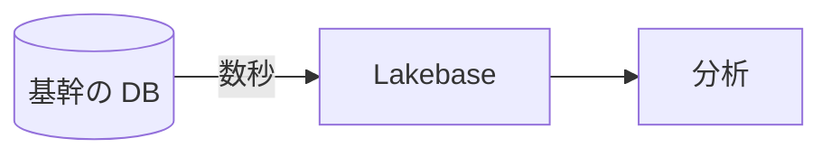

# Build and finish Japanese documents in Google Docs

[docs-write-001] Documents are built directly in Google Docs with the Docs API (history in `Research/gdocs_pipeline_20261009.md`). The source of truth for the content is the material's `build/doc.md` (markdown); docs.py builds it with named styles and a theme, and rebuilds it to the same URL (moved from doc.py on 2026-10-10. §1 below). The visual rules are in [visual.md](visual.md), and how to write the content is in `../deck-practices/content.md` (same as slides). Slides are in `../slides-build/`. Where to place the document on Drive is `../deck-practices/drive.md`.

| What you make | Read before you start writing |
|---|---|
| Google Docs (default) | This file and [visual.md](visual.md) (the visual rules for documents) |
| Reading `docs.py check` and lint output | [lint.md](lint.md) |
| Changing `docs.py`, or a build that fails or looks wrong in an unexpected way (Docs API pitfalls) | [api.md](api.md) |

```sh
K=<docs-build folder>/scripts   # the folder that holds this file. From other skills, ../docs-build/scripts relative to that skill's folder. docs.py imports the parts shared with slides (gapi.py, textlint.py, brand.py, sheet.py) from ../deck-practices/scripts
cd <folder>/build
python3 $K/docs.py init <template name>                      # when the workspace has a template and you start from it (copies doc.md. §1.3 below)
python3 $K/docs.py new <Drive folder URL> <YYYYMMDD_name>   # first build. Write the printed URL in the outline and tell the user right away (deck-drive-003 in ../deck-practices/drive.md)
python3 $K/docs.py build <URL>                                    # rebuild after edits (the URL does not change. Stops if someone edited in the UI)
python3 $K/docs.py check <URL>                                    # check (§2 below. exit 1 if there is 要修正)
python3 $K/docs.py export <URL> /tmp/<material name>.docx                 # only when the counterpart asks for Word ([lint.md](lint.md))
```

## 1. Writing doc.md and the check loop

### 1.1 Workflow

[docs-write-002] First settle the content in markdown, then build it with the template through the API, and repeat checking and fixing. As with slide page JSON, **edit doc.md (content) and docs.py's themes and components (appearance); do not edit the built document by hand**. Do not upload markdown and then edit the resulting document to bring it closer to the template (the edits live only in the document and are lost when you upload again).

1. Create doc.md with `docs.py init <template>` (if there is no template, start writing in the format of §1.2 below).
2. Write the content. Write the content agreed in the outline into doc.md without waiting for the user (deck-flow-006 in `../deck-practices/SKILL.md`). If the user says they want to settle the content in doc.md, you may do so (what readers see is the built Google Docs).
3. Build with `docs.py new` (first time) or `docs.py build`, and check with `docs.py check`.
4. Bring `要修正` to 0, check each `要確認` one by one, and open and look at the images ([lint.md](lint.md)). Put fixes into doc.md or docs.py, and go back to 3.
5. Before returning a newly made document, run `/deck-review` (`../deck-review/SKILL.md`). Put the findings into doc.md as well and rebuild. For fixes after delivery, run only the scope decided by deck-flow-017 in `../deck-practices/revise.md`.

### 1.2 doc.md format

Write the material's information in the header (between `---` lines) and markdown in the body. Do not write formatting. Font, size, color, and spacing are decided by docs.py's named styles (`STYLES`) and the theme, and are reapplied on every build (changing `STYLES` affects every material you rebuild). The text notation is the same as for slides (the "Text markup" item in `../slides-build/pages.md`. The size notation `{32:…}` is slides only).

````markdown
---
name: Acme様_Lakebase導入の検討｜Internal Only   # only the trailing confidentiality label (Internal Only, Confidential) appears in the footer
theme: acme                                      # the workspace's themes/docs/acme.json. If omitted, the default (A4, 10.5pt, navy headings)
template: proposal                               # when written from a template (check matches against it)
title: Lakebase の導入の検討について              # title and subtitle (subtitle:) of a material without a cover
---

# 1. 要旨

結論は「***分析と同じ基盤で管理したい表から移す***」です。
費用は[公式の価格表](https://www.databricks.com/product/pricing/lakebase)で見積もりました。

表: いまと移したあとの比較 {widths: 40 65 65}
| 項目 | いま | 移したあと |
|---|---|---|
| 写しの遅れ | 最大 24 時間 | 数秒 |

出典: [Lakebase の docs](https://docs.databricks.com/aws/ja/oltp/)

{width=120}

図: 写しの流れ

````

| Syntax | What is built |
|---|---|
| Header `name`, `theme`, `template`, `omit` | Material name, theme, template to match against, and sections of the template to leave out (`  - <section name>` under `omit:`) |
| Header `cover:` (a list of `  - <line>`) and `cover_left` | A cover page. Places the title lines large in the center, puts the left-hand words (such as the company name) and our own logo (`[brand] logo` in `factory.toml`; not placed if absent) side by side below, and breaks the page. Only when the template has a cover |
| Header `title`, `subtitle` | Title and subtitle (date, addressee, and so on) at the top of page 1. No cover page is made (visual.md §2) |
| `#`, `##`, `###` | Headings (H1–H3). Write numbers as text (「1. 要旨」). Go in order from H1 and do not skip levels |
| Paragraph | Separate with blank lines. You may break lines after 「。」 (they are joined when built; a space is inserted only between alphanumerics). `**bold**`, `***red bold***` (only for the key phrase of a conclusion. visual.md §3), `[text](URL)`, `` `code` ``, `<br>` (line break within a paragraph). Links and code can go inside bold and red (`***[text](URL)***`). Escape literal symbols with `\`, such as `\*` |
| Paragraph starting with `出典: …` | Source line (below tables and figures. 9pt, supporting color). Add a link (content.md §6) |
| `- `, `1. ` | Bullet lists (numbered). Items indented 2 or more spaces are level 2. Keep an introductory paragraph on the same page as the list or table that follows |
| `表: <title> {widths: 30 80 40}` with a `\|` table right below | Table. Row 1 is the header row (repeated at the top of the next page when the table crosses pages). The title appears above the table as 「表 N　…」. `widths` are ratios of column widths; the table spans from the left to the right edge of the body. Line breaks in a cell are `<br>`, a vertical bar is `\\|` |
| `{width=150}` | Figure. The image is a path inside `assets/` (`"gcp/bigquery.png"`), a path from build/, or a URL. Width is in mm (write it for a body width of 150 mm; if the theme widens the body, it scales by that ratio). The title appears below the figure as 「図 N　…」 |
| `図: <title> {width: 120}` with ```` ```mermaid ```` right below | A mermaid diagram ([syntax](https://mermaid.js.org/intro/)). docs.py draws it as PNG with the local mermaid-cli and places it as a figure (docs-write-009 below). The `図:` line can be omitted (no title). A `図:` line not followed by ```` ```mermaid ```` stays a body paragraph. Width is in mm, as for `![…]`; if omitted, it is the width at which the diagram text is the same size as the body (the body width if that exceeds it). Usually omit it |
| `> …` | Quote (customer voice, notes to the template's writer). Draws a line on the left and uses the supporting color |
| ```` ``` ```` | Code and commands. Alphanumerics in the monospace font (default Cascadia Mono), Japanese in the body font (default Noto Sans JP) |
| `\newpage` | Page break (before an appendix, and so on) |
| `<!-- … -->` | Notes that are not built (the material it was based on, reasons for changes) |

- docs.py numbers figures and tables in order of appearance. When the body refers to them, as in 「表 1 のとおり」, check the number in the text after building.
- Check each build warning (the number of column widths does not match the columns, a figure is wider than the body, the line after `表:` is not a table) one by one.
- [docs-write-010] **Theme:** The default is A4, 10.5pt body, navy headings (visual.md §1). To match a company document template, write the workspace's `themes/docs/<name>.json` (a theme file. The file name is the theme name, alphanumerics and - _), and write `theme: <name>` in the header of doc.md. Match the format to the slide theme files (slides-theme-036 in `../slides-build/themes.md`): the header `apiVersion` (`docs/v1`) and `kind`, and `description`, `font`, `mono`, and `colors` are the same keys (role names in `colors` are also the same as for slides when they mean the same thing). `page`, `margins`, and `styles` are document-only keys. Values not written stay at the default. Unknown keys and roles, and values that cannot be written (colors that are not 6 hex digits, sizes that are not positive, and so on), stop before building with their location (factory-doctor checks with the same function). Color contrast is not checked (to match the colors of company document templates), so when you write colors, check on the images that the text is readable. A doc.md without `theme:` uses `[docs] default_theme` (or the default `standard` if absent). However, if theme files exist and `theme:` is missing, `docs.py new` prints the list and stops (to make you choose. To keep the default, write `theme: standard`). Choose which one to use per material (`docs.py themes` prints names and descriptions. step 5 in `../deck-practices/start.md`). Themes on paper other than A4 (Letter, and so on) do not get the lint findings 「用紙が A4 でない」 or 「1 行の字数が多い」 (A4 themes get 「1 行の字数が多い」 like other A4 documents). `[docs.themes]` in `factory.toml` (the way of writing until 2026-10-19) is not read (factory-doctor reports it as `要修正`).
  ```json
  {"apiVersion": "docs/v1", "kind": "theme",
   "description": "米国の本社に出す文書。英語版のテンプレートに合わせた Letter の版面",
   "font": "Noto Sans JP", "mono": "Cascadia Mono",
   "colors": {"HEAD": "4A86E8", "TABLE_HEAD": "F3F3F3", "TABLE_HEAD_TEXT": "303F47"},
   "page": [215.9, 279.4], "margins": [12.7, 12.7],
   "styles": {"BODY": {"size": 10}, "H1": {"size": 12, "above": 16, "below": 6},
              "H2": {"size": 11}, "H3": {"size": 10.5, "color": "303F47", "spacing": 90}}}
  ```
  | Key | Content |
  |---|---|
  | `description` | Which materials and audiences it is for, and when not to use it (printed by `docs.py themes`. Same as slides) |
  | `font`, `mono` | Body font and monospace font for code. Allowed are `JP_FONTS` in `slides.py` (fonts confirmed to render Japanese) and DM Sans (Japanese falls back to a Gothic font Google chooses. Not confirmed in Docs). For monospace, fonts with ligatures (`LIGATURE_MONO`) are stopped |
  | `colors` | Role → 6 hex digits without `#`. `HEAD` (title and headings. Default `1B3139`), `TEXT` (body. `303F47`), `SUB` (subtitle, figure and table titles, source lines, quotes, footer. `5A6F77`), `RULE` (rules and the quote line. `DCE0E2`), `PANEL` (code background. `EEEDE9`), `RED_TEXT` (`***red bold***`. `CC2B17`), `TABLE_HEAD` and `TABLE_HEAD_TEXT` (background and text of the table header row. `1B3139` and `FFFFFF`). Colors of mermaid diagrams are also taken from here |
  | `page`, `margins` | Paper width and height, and top/bottom and left/right margins (mm) |
  | `styles` | Per named style (`TITLE`, `SUBTITLE`, `H1`, `H2`, `H3`, `BODY`): `size` (pt), `color` (6 digits. If not written, title and headings use `HEAD`, subtitle `SUB`, body `TEXT`), `above` and `below` (space above and below. pt), `spacing` (line spacing in %. Line pitch is "1.88 × font size × %". [api.md](api.md)). Defaults are `STYLES` in `docs.py` |
  If `font` and `mono` are not written, they are Noto Sans JP and Cascadia Mono. The line pitch and character-width estimates stay at the values measured with these 2 fonts (with other fonts, characters per line and page breaks shift). A name not in Google Fonts is silently rendered in another font. When you write one, build a document with that theme and check 「PDF の書体」 in `docs.py check` and the images. The lint's font check in `docs.py check` compares against the font that `docs.py build` recorded in the document (the theme's font at build time). Documents without that record (built with an earlier version), and document JSON passed directly to `lint.py`, are compared against the default font.
- How to choose images and where they come from (`assets/README.md`, Iconify, each company's icons) is the same as for slides (`../slides-build/images.md`). To draw a figure in Google Slides and paste it, turn it into an image with `gslides.py thumb` and then place it with ``.
- [docs-write-009] **mermaid:** Write diagrams that boxes and arrows are enough for (flows, sequences, states, and so on) as ```` ```mermaid ```` in doc.md (the content stays in doc.md, rebuilding after an edit changes the diagram too, and GitHub shows it as is). Architecture diagrams that need icons or logos are drawn in Google Slides and pasted. docs.py draws locally with mermaid-cli (`@mermaid-js/mermaid-cli` with a pinned version via `npx`. `MERMAID_CLI` in `docs.py`. The first run takes a few minutes. Needs Node.js). Do not use a local `mmdc` of unknown version (rendering changes between versions and no longer matches the PNG fingerprint). Do not give diagram content to outside services (such as mermaid.ink) (`../slides-build/assets/README.md`). Colors come from the theme's `colors` (box background `PANEL`, border `HEAD`, lines `SUB`, text `TEXT`), the font is the theme's body font, and text is drawn at the same size as the body. The font is whatever is installed locally (if it is not installed, another Gothic font is used, so check on the images). The PNG is placed at `build/mermaid/<fingerprint>.png` and not redrawn if the content, colors, font, and mermaid-cli version are the same (each build deletes unused PNGs). The local fonts and the Chrome that mermaid-cli fetches are not part of the fingerprint, so to redraw after replacing them, delete `build/mermaid/` and rebuild. If shrinking to the body width makes the diagram text smaller than 9pt, a build warning appears (for wide diagrams use `flowchart TB` or split the diagram). Syntax errors stop with the mermaid-cli output.

### 1.3 Templates

The source of truth for a template's structure is the workspace's `rules/docs-build/templates/<name>/doc.md` (it is a company's document format, so it is not in the plugin. If there is no template, write doc.md from scratch), and the URL of the built sample is in `[docs.templates]` in `factory.toml`. `docs.py init <name>` copies from here.

- **Content:** the order of sections (H1), example sentences and bullets per section, example tables (the header row defines the columns), notes to the writer (`> <担当: SA>`), tags (`[会社名]`, `[氏名]`, and so on: `[ ]` that are not links), and the theme and cover. The header `source:` is the URL of the document it was based on (the English version), and `skeleton_ok:` lists the sections whose skeleton is accepted as different from the original, with reasons (`  - <section name>: <reason>`).
- **Starting to write:** `docs.py init <name>` copies doc.md and adds `template: <name>` to the header (removing `source` and `skeleton_ok`). Replace the tags and notes with content. While tags and notes remain, check reports `要修正`, so no leftover placeholders remain.
- **Matching (check):** whether all H1 sections of the template are present (to leave one out, write it in the header `omit:`), the order of sections, whether each section has a table with the same columns as the example table (tags in column names match anything), and the cover and theme. Added sections (H1) are reported as `要確認`. H2 inside sections and tables other than the example tables are free.
- [docs-write-003] **Making or fixing a template:** Do not copy the given template document and replace only the text. Copy the sections, order, and content (nested bullets, example tables, notes to the writer) into `rules/docs-build/templates/<name>/doc.md` (translate if it is in English), write `source:` in the header, and build with docs.py (as with slides and code, so that you make it while comparing with the original and checking with the lint). Running `docs.py check <sample URL>` in the template's folder compares the skeleton per section with the original document (number of items per bullet level, table size, number of figures). Fix the differences or write the reason in `skeleton_ok:`. For appearance, compare side by side with page images of the original document (`docs.py export <URL> /tmp/x.pdf` and `pdftoppm`). Write what you changed (formatting, cover, wording fixed by the lint) with reasons in the notes at the top of doc.md. Do not build into a copy of an old Google Doc. Even with the same line spacing value, lines are rendered tighter (the setting does not show in the API)
- **When you edit docs.py, lint.py, or doc_layout.py,** pass `--selftest` for all 3, rebuild the template samples, and run check (`docs.py build` and `check` in that folder. Same role as `template.py visual` for slides). Changing a component changes the appearance of the materials that use it when they are rebuilt.
- Changing a template's sections or tables changes the matching of the materials written with it. After changing one, run check on the materials written with that template (`grep -rl "template: <name>" Customers Internal`).

## 2. What docs.py check does

1. Writes the `documents.get` JSON to `/tmp/docs_<first 8 chars of the ID>/doc.json`
2. Writes the text to `text.md` (headings as `#`, each table row joined with ` | `, images as `［画像］`. Passed to reviews)
3. Runs `lint_gdoc` in `doc_lint.py` on the JSON ([lint.md](lint.md))
4. Saves Drive's PDF export (the pages Google rendered) as `doc.pdf` and page images as `p-N.png` (110 dpi. 910 × 1286 for A4)
5. `doc_layout.py` measures the layout from line positions in the PDF (`bbox.html` from `pdftotext -bbox-layout`) and the images ([lint.md](lint.md))
6. Prints the fonts used in the PDF (Arial for bullet symbols and numbers is fine, because the API cannot change it)
7. **Matching doc.md against the built document** (turns the doc.md in the current folder and the built document's JSON into the same one-element-per-line form and compares them. `canon_doc`, `canon_json`): paper and margins, named styles (font, size, bold, color), order and kind of blocks (headings, paragraphs, source lines, quotes, bullet levels and numbering, table size and column widths, cells, figure widths, figure and table titles, code, page breaks, cover), and text, bold, links, and code. Differences are `要修正`. The cause is one of: not rebuilt, edited in the UI, or docs.py's building is broken. Rebuild, or fix docs.py
8. **Matching against the template** (when the header has `template:`. §1.3 above). Missing sections, table columns, cover, theme, and leftover tags and notes are `要修正`; section order and added sections are `要確認`
9. **Comparing the skeleton with the original document** (when the header has `source:`. Run in the template's folder). Differences are `要確認` (only counts for sections listed in `skeleton_ok:`)

[docs-write-004] If the lint or matching has `要修正`, it returns exit 1. If the doc.md to match against is not in the current folder, it is looked up from the folder that `docs.py build` recorded in the document (`docs_py_src` in Drive's appProperties. A path relative to Documents). So 7–9 run no matter where you run it from, as with `/deck-review`. If it is not found, or the doc.md `name` is not in the document's name, it reports that matching was not done.

## 3. Reading the results

- **Images:** After building, open and look at the images of all pages yourself, and fix. Look at table column widths and wrapping, figure sizes, whether a figure and its title or a table and its title are split across pages, spacing between paragraphs, and headings left at the end of a page. Judge the finish by these Google-rendered images.
- **Text:** Read `text.md` for missing content or wrong order.
- **lint:** Bring `要修正` to 0. Check each `要確認` one by one, and either fix it or be able to say why it stays (example: 「顧客の発言の引用に だ・である が残るのはよい」).
- **Before delivering:** Review a newly made document as a whole with `/deck-review <Google Docs URL>` (`../deck-review/SKILL.md`) before returning it to the user. For fixes after delivery, run only the scope decided by deck-flow-017 in `../deck-practices/revise.md`.
- When checking is done, you may delete `/tmp/docs_<ID>/`. Do not keep it in the material's folder.

## 4. Deliverables and Drive

- **Deliver as a Google Docs URL. Do not make PDFs.** Only when the counterpart asks for Word, export to docx with `docs.py export` and give that (the Google Docs on Drive is the source of truth. Do not edit the exported docx).
- [docs-write-006] **Location, name, renaming, and sharing are the same as for slides** (`../deck-practices/drive.md`). Customer-facing ones go in the customer's folder under the shared drive's `10_Customers` (「Google Drive の置き場所」 in `references_index.md`); ones not tied to a customer (internal) go in a topic folder under `drive.docs` in `factory.toml` (Docs inside AI Deck Factory), separate from the Slides folder for slides. The name is `YYYYMMDD_<material name>`. Add the materials you made to 「Google Drive の置き場所」 in `references_index.md`, and write the URL in the outline and the report.
- **Do not edit in the UI; edit doc.md and rebuild.** Rebuilding erases edits made in the UI. If someone edited in the UI, or there are unresolved comments, `docs.py build` stops. Put the edits and the responses to comments into doc.md, then rebuild with `--force`.
- [docs-write-007] **Stop rebuilding a material once people start editing it in the UI.** When it reaches the stage where you edit it together with the customer or colleagues in the UI, edit in the UI from then on (same as slides whose `build/` was deleted). Write 「<日付> から画面で直す」 in the outline.
- Do not delete `build/doc.md` until there is no prospect of rebuilding ("What to keep" in `../deck-practices/deliver.md`).

## 5. docx

[docs-write-008] Do not make new documents as docx. Existing docx files (3 in `Customers/`) and docx received from Word are uploaded to Drive and converted to Google Docs before editing. The tools for editing docx as docx (docx-js, `check.sh`, rendering images with LibreOffice) were removed (the backup is in the workspace's `Archive/docx_pipeline_20261010/`). Documents with a company template, such as PoC plans, follow its chapter structure (templates are in the workspace's `rules/docs-build/templates/`). Examples before 2026-10-09 are customer-facing materials (docx).
